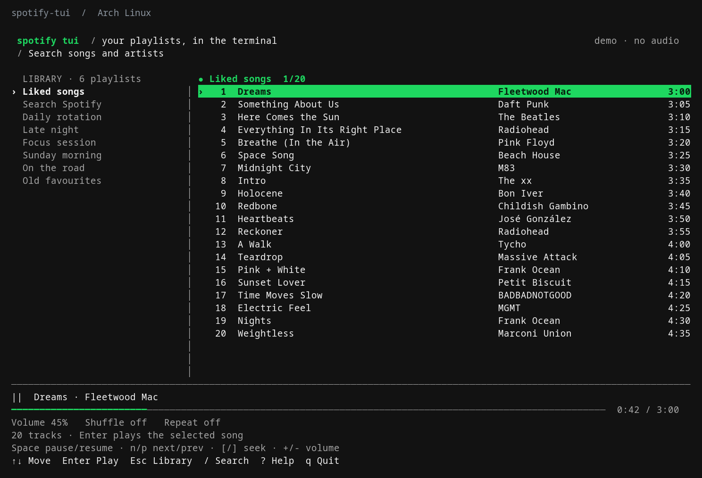

# spotify tui

So Spotify was taking up way too much RAM and I just wanted to play my playlists. I made a terminal player coz I don't need a whole desktop app sitting there while I'm working.

Go for the TUI, Rust for the local playback helper. **Linux x86_64 and Apple Silicon macOS.** Go/Rust releases are built and checked on native GitHub runners. macOS setup and verification limits are in [the Mac guide](docs/MACOS.md).



Actual terminal capture of `--demo`, using generic sample playlists and songs. The demo produces no audio and reads no account data.

[What's new](CHANGELOG.md) · [Full release details](docs/releases/v0.4.0.md)

## Download

**[Download for Linux x86_64](https://github.com/wrestle-R/Spotify-Tui/releases/download/v0.4.0/spotify-tui_0.4.0_linux_amd64.tar.gz)** · **[Download for Apple Silicon Mac](https://github.com/wrestle-R/Spotify-Tui/releases/download/v0.4.0/spotify-tui_0.4.0_darwin_arm64.tar.gz)** · [Release notes and checksums](https://github.com/wrestle-R/Spotify-Tui/releases/tag/v0.4.0)

The archive includes the TUI, Rust helper and local installer. Linux needs glibc 2.39+; Mac needs Apple Silicon and macOS 15+. Both need a Premium account and separate [Soloist setup](docs/SETUP.md#local-playback-through-official-soloist). Soloist comes from Spotify and isn't bundled here. macOS binaries are ad-hoc signed, not Apple-notarized.

The repo and downloads are public:

```bash
curl -fL https://github.com/wrestle-R/Spotify-Tui/releases/download/v0.4.0/download.py -o download.py
less download.py
python3 download.py download --destination ./spotify-tui-download
bash ./spotify-tui-download/install.sh
~/.local/bin/spotify-tui
```

Python 3.9+ is needed only for downloading/installing. The downloader verifies SHA-256 before extraction and prints where it saved the files. Installation goes under `~/.local`; it doesn't need sudo. It keeps previous build directories for rollback. See [downloads](docs/DOWNLOADS.md) for manual verification and a different install prefix.

Try the keyboard flow without an account:

```bash
~/.local/bin/spotify-tui --demo
```

## First run

Use your own Spotify Developer application's public client ID, register `http://127.0.0.1:43821/callback`, then:

```bash
~/.local/bin/spotify-tui setup --client-id YOUR_PUBLIC_CLIENT_ID --soloist-path /absolute/path/to/soloist
~/.local/bin/spotify-tui login
~/.local/bin/spotify-tui provider-key
~/.local/bin/spotify-tui
```

Sign-in happens in your normal browser. `provider-key` hides the key while you type. Select **Spotify TUI Local** in Spotify's device picker for the initial pairing; you can close the official player afterward. Full [setup instructions](docs/SETUP.md) cover verification, the keyring and pairing.

The Linux tray starts with the player when your panel supports it. macOS runs the terminal player without a tray. `q` leaves music playing; `Q` stops music and exits the tray. The app checks stable updates on startup; **Ctrl-U** installs a verified update and restarts. [Tray and update help](docs/SETUP.md#tray-and-updates).

The [website source](next/) includes the landing page, account setup guide and changelog. See [website instructions](next/README.md) to run it locally.
